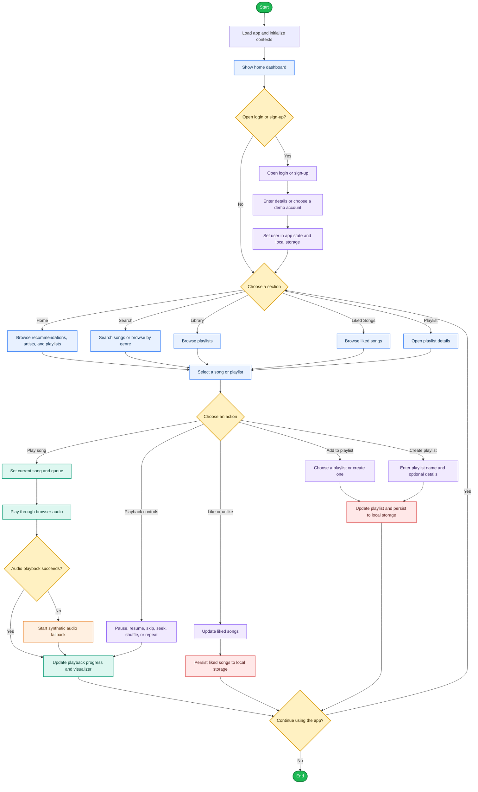

# Spotify Clone — Activity Diagram

This diagram summarizes the main user journey through the React app: opening the app, browsing music, controlling playback, and managing liked songs and playlists. User and playlist data are persisted in browser local storage; authentication is a client-side demo flow, and a demo user is available by default.

