# Spotify Clone - Flow Screenshots

This visual guide shows the main screens and dialogs in a typical user journey. The screenshots are captured from the running app and use the bundled demo account and catalog.

## 1. Home

Start by browsing recommendations, featured songs, playlists, and artists.

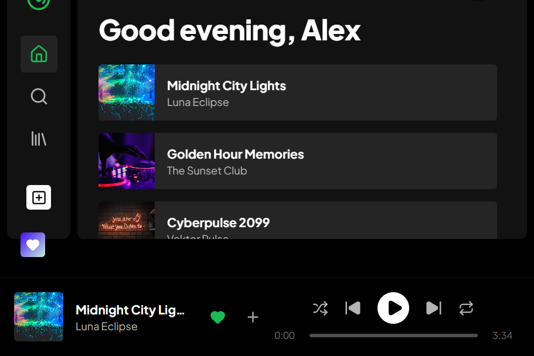

## 2. Search

Search the catalog and review matching songs and artists.

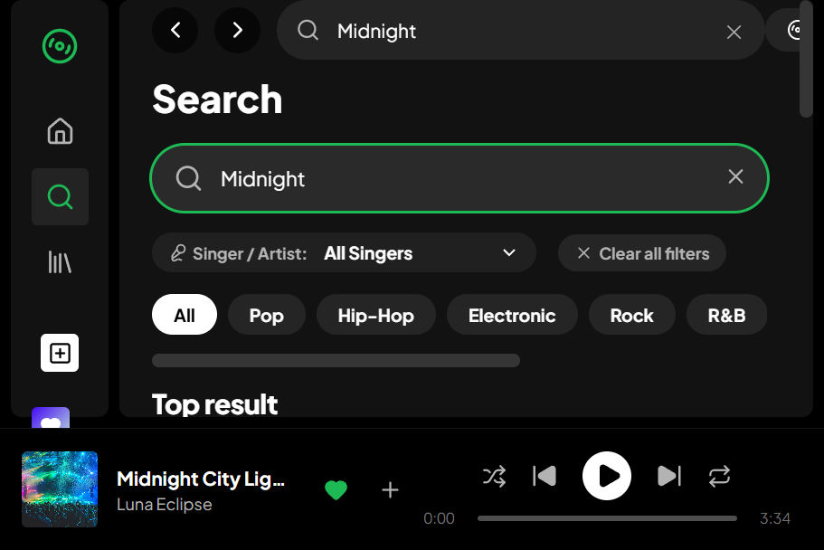

## 3. Library

Browse playlists and open Liked Songs from the library.

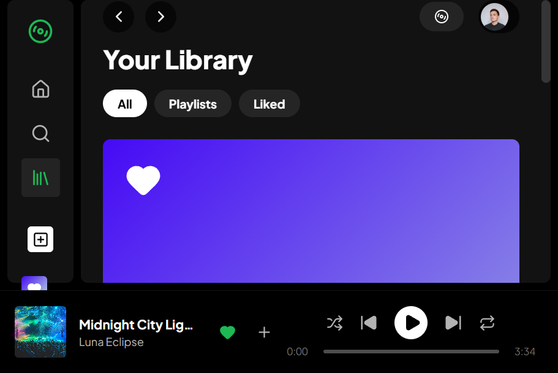

## 4. Liked Songs

View and play the saved song collection.

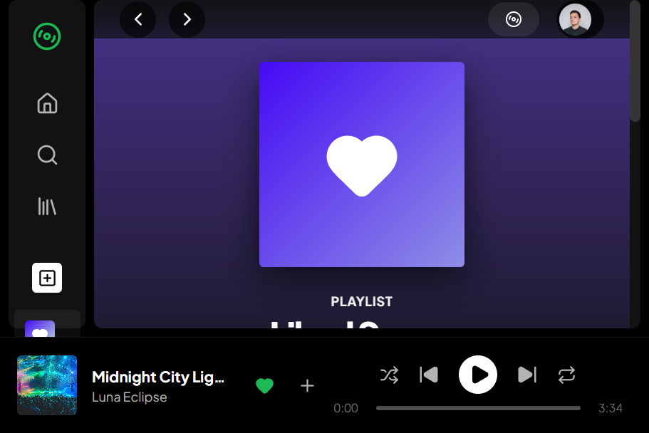

## 5. Playlist Details

Open a playlist to view its tracks and recommendations.

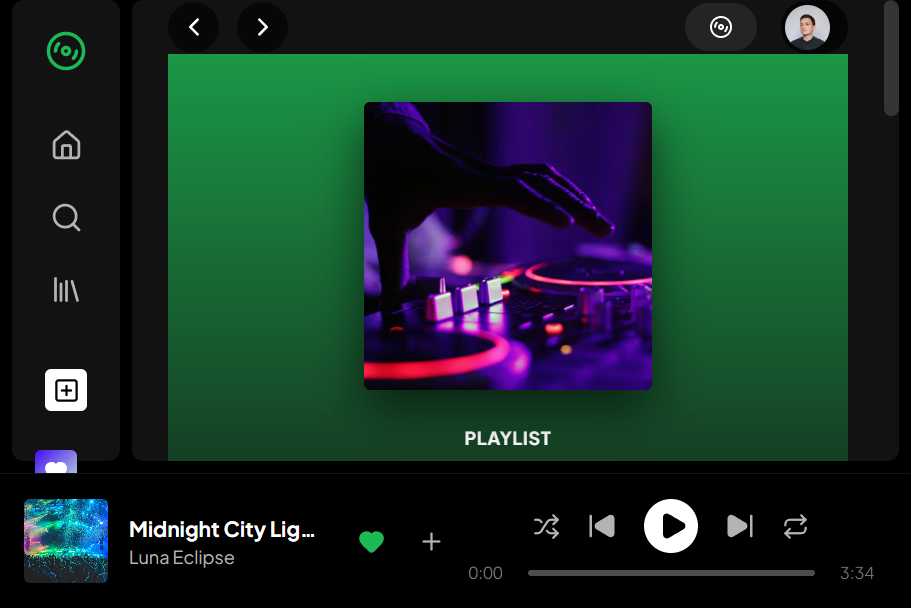

## 6. Immersive Player

Open the expanded player to view artwork and the visualizer.

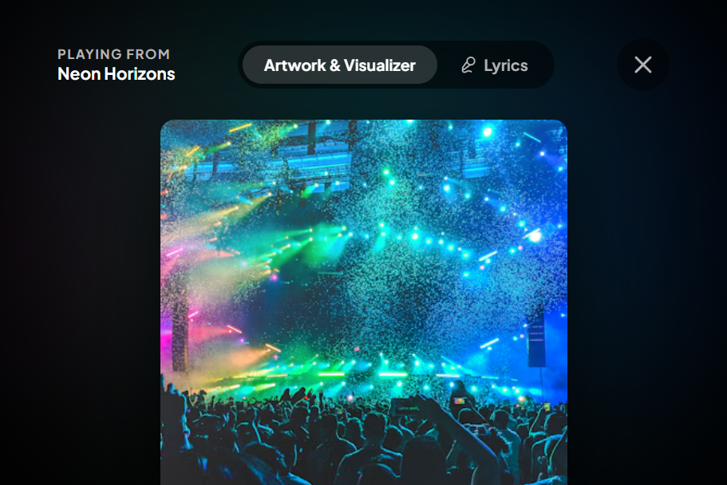

Switch to the lyrics tab while playback is active.

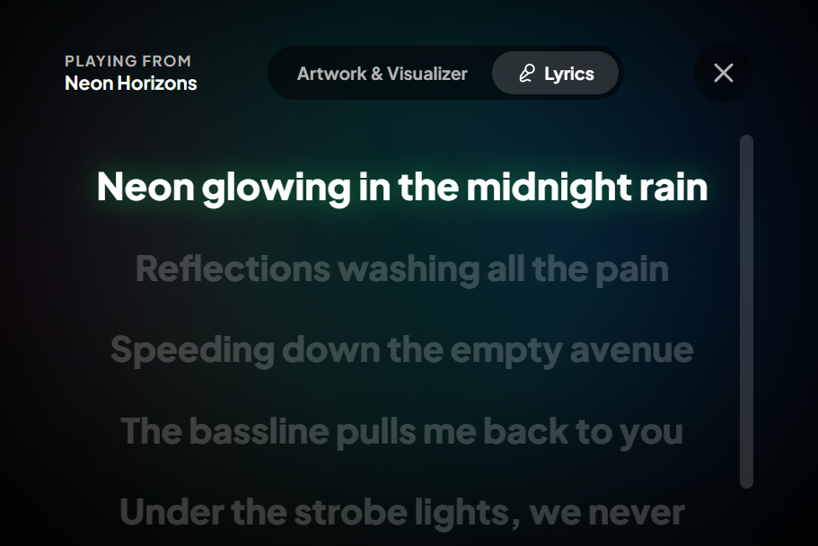

## 7. Playlist Actions

Create a playlist by entering a name and optional details.

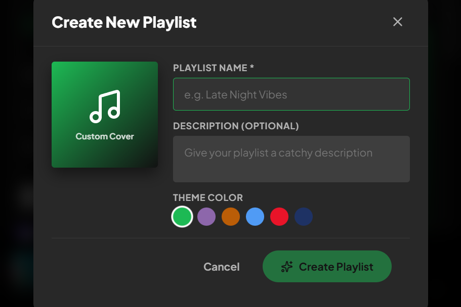

Add the current song to an existing playlist or create one from the add dialog.

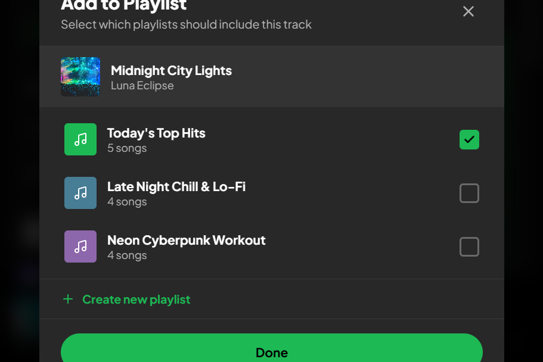

## 8. Account Flow

The profile menu shows the active demo account and account actions.

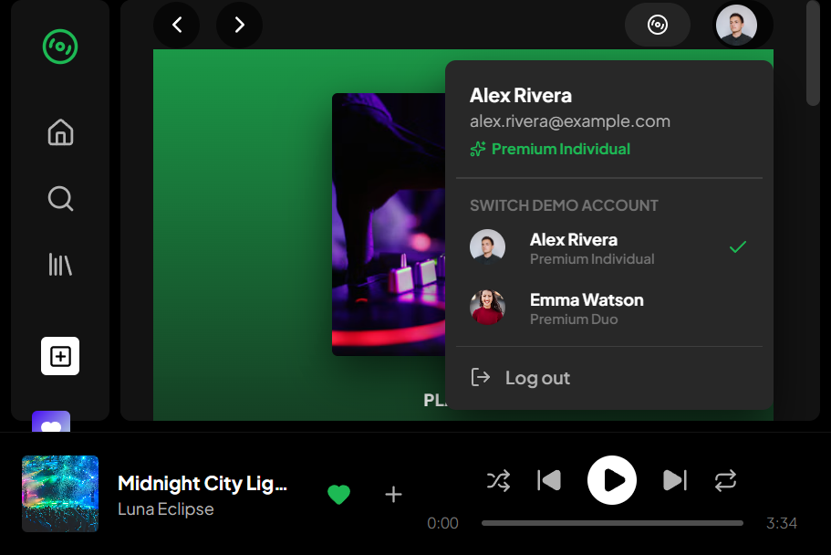

Visitors can log in with the demo accounts or enter email details.

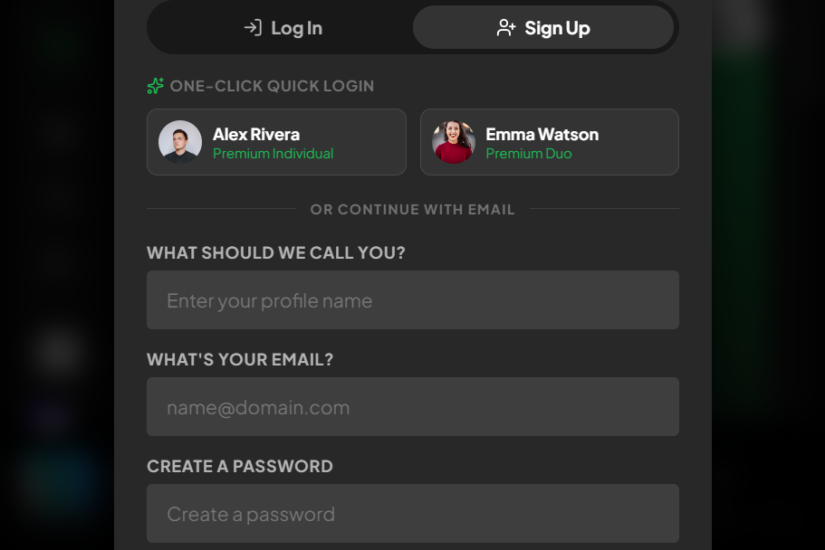

The sign-up tab collects basic profile details.

